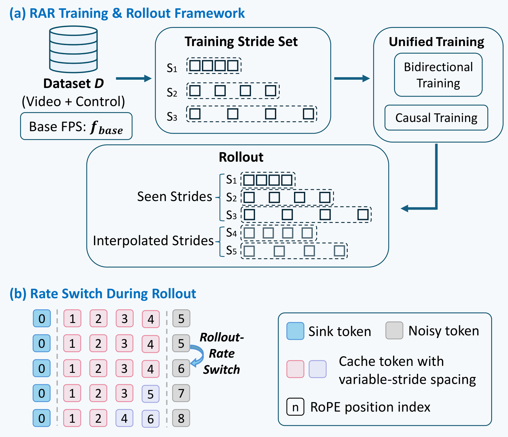
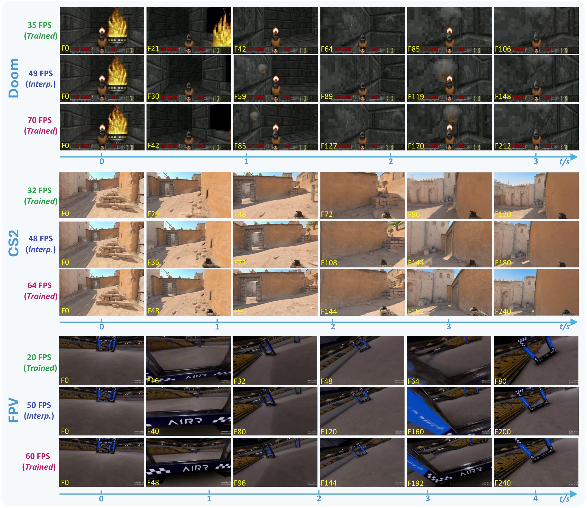
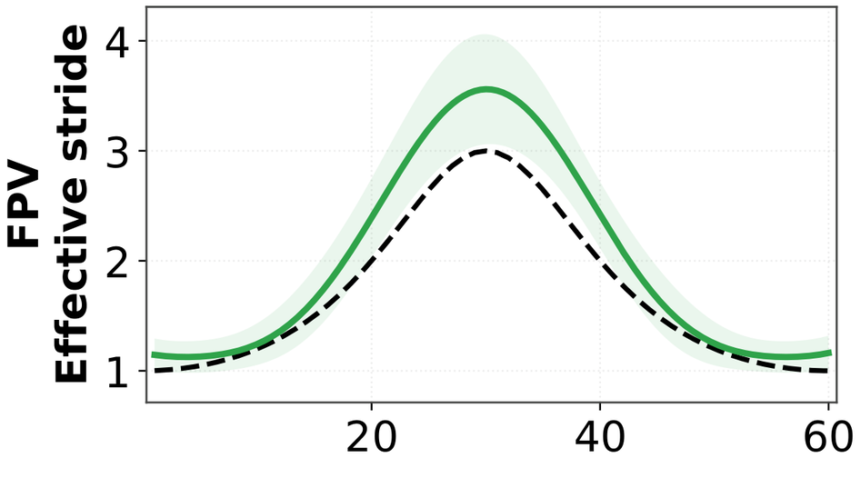
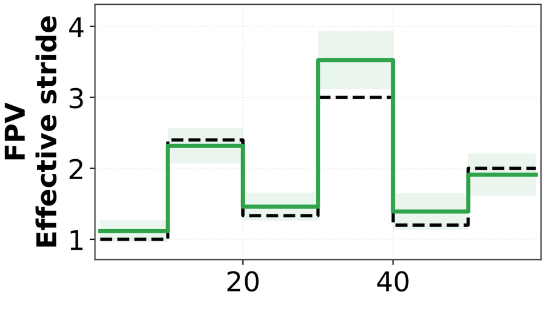
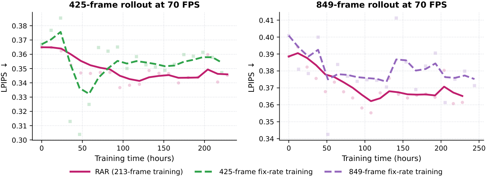

<div align="center">

# RAR: Rate-Adaptive Rollout for Time-Consistent Interactive World Models

Yaoyang Liu<sup>1*</sup>, Dongyu Yan<sup>2*</sup>, Yihua Du<sup>2</sup>, Shengju Qian<sup>3</sup>, Zeke Xie<sup>2</sup>, Xin Wang<sup>3</sup>, Ying-Cong Chen<sup>2</sup>, Long Chen<sup>1&dagger;</sup>

<sup>1</sup>HKUST &nbsp;&nbsp; <sup>2</sup>HKUST (GZ) &nbsp;&nbsp; <sup>3</sup>Tencent LightSpeed

<sup>*</sup>Equal contribution &nbsp;&nbsp; <sup>&dagger;</sup>Corresponding author

<!-- TODO before going public: check the project-page URL, fill in the arXiv ID, and link the code -->
[](https://lazysheeeeeep.github.io/RAR/)
[](https://arxiv.org/abs/XXXX.XXXXX)


</div>

## TL;DR

Interactive world models are usually trained and rolled out at one fixed temporal rate. This couples the pace of the
generated world to the runtime throughput, and it forces a trade-off between fine motion and long physical horizons.
**RAR** decouples the two with **Stride-RoPE**, a physical-time temporal RoPE coordinate, together with
**synchronized multi-stride sampling** of videos and controls. One model can then roll out at training rates and at
unseen intermediate rates, and it can switch rates on the fly.

**Videos and interactive demos are on the [project page](https://lazysheeeeeep.github.io/RAR/).**

## Highlights

- **One model, many rollout rates.** RAR generates at its training rates and at unseen intermediate rates. Across Doom,
  CS2 and FPV, the speed ratio at all six interpolated rates stays within 4.0% of the ideal value.
- **Online rate switching.** The target rate can change in the middle of a rollout without clearing the KV cache. The
  measured stride follows the target schedule, with a Pearson correlation of up to 0.998 (FPV, smooth schedule).
- **A better rate–horizon trade-off.** Under matched wall-clock time, a 213-frame RAR model outperforms 70 FPS baselines
  trained on 425- and 849-frame windows, which cost 1.56× and 5.25× more time per update.
- **Works with pretrained world models.** Adapting SANA-WM with RAR improves LPIPS at every rate.

## Abstract

Video-based interactive world models aim to enable real-time, user-controllable environments. Yet most existing systems
are trained and rolled out at a fixed temporal rate, limiting both runtime-rate adaptation and physical-horizon
coverage, a limitation we term **temporal-rate coupling**. Specifically, when runtime generation throughput differs
from the learned temporal rate, the generated world evolves unintentionally more slowly or quickly. Moreover, using a
single temporal rate imposes an inherent trade-off between temporal granularity and physical horizon: higher rates
capture finer motion but cover a shorter duration under a fixed context window. To address both limitations, we
introduce **Rate-Adaptive Rollout (RAR)**, a framework that enables interactive world models to roll out at
controllable temporal rates. At its core, *Stride-RoPE* aligns latent frames sampled at different rates on a shared
physical-time coordinate, enabling consistent multi-rate rollout, unseen-rate generalization, and online rate switching
without discarding history. Meanwhile, RAR uses multi-stride video sampling to enable joint learning of fine-grained
dynamics and long-horizon evolution. Across action- and camera-controlled environments, RAR achieves temporally
consistent multi-rate rollout and online rate switching while preserving high-rate generation quality and extending
physical horizons under matched training budgets. RAR also transfers to pretrained world models while preserving
perceptual quality.

## Method

### Stride-RoPE

A video sampled at rate $f$ has temporal stride $s(f) = f_{\mathrm{base}} / f$. Stride-RoPE places latent frame $n$ at
temporal position $p_n = n\,s(f)$, so equal physical-time intervals give equal relative rotary phases at every rate:

$$(p_m - p_n)\,\omega_k = f_{\mathrm{base}}\,(t_m - t_n)\,\omega_k .$$

It adds no parameters, and at $f = f_{\mathrm{base}}$ it reduces exactly to standard RoPE.

<p align="center"></p>

### Rate-Adaptive Rollout

<p align="center"></p>

- **Multi-rate training.** Videos and controls are sampled together at several strides, always with the same number of
  frames. Fine strides learn fast dynamics, and coarse strides reach longer horizons at no extra cost.
- **Rate-controlled rollout.** The stride sets the rollout rate, $f_{\mathrm{rollout}} = f_{\mathrm{base}} / s$. Choosing
  the stride to match the runtime throughput keeps the generated world in real time.
- **Online rate switching.** Positions accumulate the strides, $p_{n+1} = p_n + s_n$. With pre-RoPE keys in the KV cache,
  the rate can change mid-rollout without resetting the cache.

## Results

### Multi-rate generation

One RAR model rolls out the same scene at three target rates, including an interpolated rate never seen in training.
Frames at the same physical time match across rates.

<p align="center"></p>

<details>
<summary>Quantitative results (click to expand)</summary>

The number of generated frames is fixed within each environment. Drift is the ratio of last-quarter to first-quarter
LPIPS. SR measures rate fidelity, with an ideal value of 1.

| Environment | FPS | Type | Horizon (s) | LPIPS ↓ | Drift | DOVER ↑ | SR → 1 |
|:--|--:|:--|--:|--:|--:|--:|--:|
| Doom | 14 | Train | 15.1 | 0.4279 | 1.17 | 0.3205 | 0.923 |
| | 28 | Interp. | 7.6 | 0.4179 | 1.22 | 0.3269 | 1.003 |
| | 35 | Train | 6.1 | 0.3991 | 1.27 | 0.3153 | 0.999 |
| | 49 | Interp. | 4.3 | 0.4003 | 1.26 | 0.3156 | 0.986 |
| | 70 | Train | 3.0 | 0.3852 | 1.34 | 0.3049 | 1.082 |
| CS2 | 16 | Train | 15.0 | 0.6489 | 1.52 | 0.3928 | 0.983 |
| | 24 | Interp. | 10.0 | 0.6200 | 1.60 | 0.4187 | 1.009 |
| | 32 | Train | 7.5 | 0.5980 | 1.61 | 0.4402 | 0.970 |
| | 48 | Interp. | 5.0 | 0.5944 | 1.67 | 0.4369 | 1.024 |
| | 64 | Train | 3.8 | 0.5823 | 1.69 | 0.4323 | 1.097 |
| FPV | 20 | Train | 12.0 | 0.5247 | 1.35 | 0.2827 | 1.031 |
| | 30 | Train | 8.0 | 0.5161 | 1.41 | 0.2766 | 1.040 |
| | 40 | Interp. | 6.0 | 0.5011 | 1.42 | 0.2733 | 0.960 |
| | 50 | Interp. | 4.8 | 0.5035 | 1.45 | 0.2843 | 1.007 |
| | 60 | Train | 4.0 | 0.4944 | 1.49 | 0.2956 | 0.917 |

</details>

### Online rate switching

RAR follows a changing target rate within one continuous rollout, under a smooth schedule and an abrupt schedule of six
constant-stride segments. The plots show the target stride (dashed) and the stride measured from calibrated optical flow
on FPV.

<p align="center">
  
  
</p>

### Rate–horizon trade-off

Under approximately matched wall-clock time on Doom, the 213-frame RAR model is compared with fixed-rate training on
425- and 849-frame windows.

<p align="center"></p>

### Transfer to pretrained world models

We adapt the pretrained SANA-WM in two stages: a bidirectional teacher fine-tuned on 10, 20 and 30 FPS data (3k steps),
then 3k steps of multi-rate Self-Forcing for a streaming student. LPIPS improves at every rate, and rate fidelity
improves at 10, 20 and 30 FPS. See the [project page](https://lazysheeeeeep.github.io/RAR/) for the videos.

## Citation

```bibtex
@article{liu2026rar,
  title   = {RAR: Rate-Adaptive Rollout for Time-Consistent Interactive World Models},
  author  = {Liu, Yaoyang and Yan, Dongyu and Du, Yihua and Qian, Shengju and
             Xie, Zeke and Wang, Xin and Chen, Ying-Cong and Chen, Long},
  journal = {arXiv preprint arXiv:XXXX.XXXXX},
  year    = {2026}
}
```

## License

The content of the project page is licensed under [CC BY-SA 4.0](https://creativecommons.org/licenses/by-sa/4.0/).
