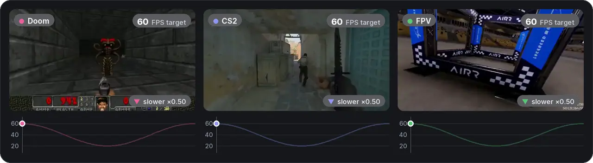
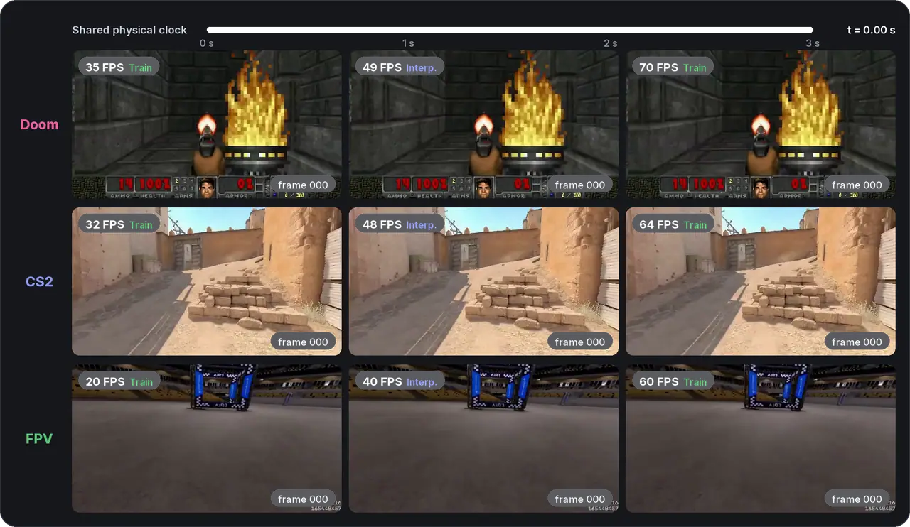
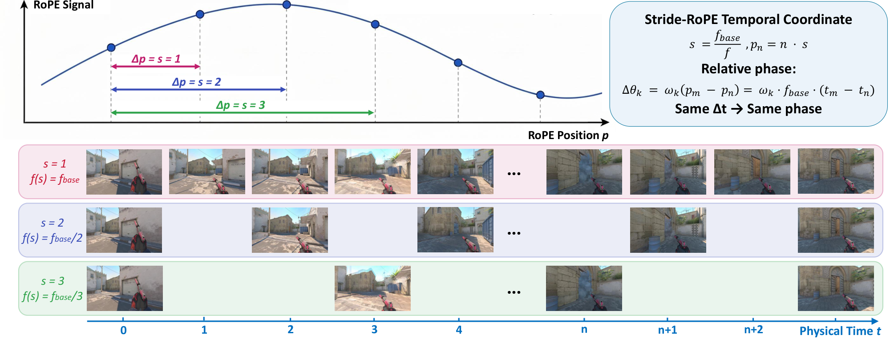

<div align="center">

<picture>
  <source media="(prefers-color-scheme: dark)" srcset="static/readme/title_dark.svg">
  
</picture>

<p>
Yaoyang Liu<sup>1*</sup>, Dongyu Yan<sup>2*</sup>, Yihua Du<sup>2</sup>, Shengju Qian<sup>3</sup>, Zeke Xie<sup>2</sup>, Xin Wang<sup>3</sup>, Ying-Cong Chen<sup>2</sup>, Long Chen<sup>1&dagger;</sup>
</p>

<p>
<sup>1</sup>HKUST &nbsp;&nbsp; <sup>2</sup>HKUST (GZ) &nbsp;&nbsp; <sup>3</sup>LIGHTSPEED<br>
<sub><sup>*</sup>Equal contribution &nbsp;&nbsp; <sup>&dagger;</sup>Corresponding author</sub>
</p>

<!-- TODO before going public: fill in the arXiv ID (button + BibTeX) -->
<a href="https://lazysheeeeeep.github.io/RAR/"><picture><source media="(prefers-color-scheme: dark)" srcset="static/readme/btn_page_dark.svg"></picture></a>&nbsp;
<a href="https://arxiv.org/abs/XXXX.XXXXX"><picture><source media="(prefers-color-scheme: dark)" srcset="static/readme/btn_arxiv_dark.svg"></picture></a>

</div>

<br>

<p align="center">
  
</p>
<p align="center"><sub>
One model steers its generation rate <b>while it generates</b>. Clips play at a fixed frame rate, so the world slows down
when the target rate is high and speeds up when it is low.
</sub></p>

## 💡 TL;DR

Interactive world models are usually locked to one temporal rate. **RAR** puts frames from every rate on a shared
physical-time axis (**Stride-RoPE**) and trains on several strides at once, so **one model can roll out at any rate and
change it on the fly**.

## 📣 News

<!-- TODO: adjust the dates when the repository goes public -->
- **2026.10** &nbsp; The [project page](https://lazysheeeeeep.github.io/RAR/) is online.
- **Coming soon** &nbsp; The arXiv preprint and the code.

## ✨ Highlights

- 🎚️ **One model, any rollout rate**, including rates never seen in training.
- 🔀 **Switch rates mid-rollout**, without resetting the KV cache.
- 🔭 **Longer physical horizons** for the same training budget.
- 🧩 **Plugs into pretrained world models** with a short fine-tune.

<p align="center"></p>
<p align="center"><sub>Three rollout rates, one physical clock: every rate shows the same scene at the same moment.</sub></p>

## 🛠️ Method

**Stride-RoPE** places each frame at its physical time instead of its index, so frames sampled at different rates share
one temporal axis. Training mixes several strides, and at rollout time the stride sets the rate.

<p align="center"></p>

## 📝 TODO

- [x] Release project page
- [x] Release arXiv paper
- [ ] Release inference code

## 📖 Citation

```bibtex
@article{liu2026rar,
  title   = {RAR: Rate-Adaptive Rollout for Time-Consistent Interactive World Models},
  author  = {Liu, Yaoyang and Yan, Dongyu and Du, Yihua and Qian, Shengju and
             Xie, Zeke and Wang, Xin and Chen, Ying-Cong and Chen, Long},
  journal = {arXiv preprint arXiv:XXXX.XXXXX},
  year    = {2026}
}
```
